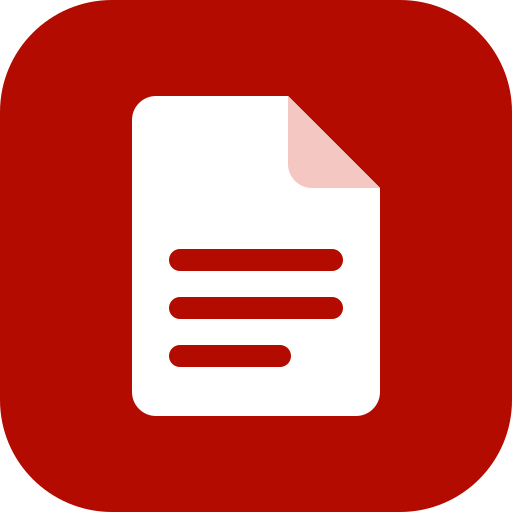

# PdfCraft app icon (SMS build)

A red rounded tile (`#b30b00`, `viewBox="0 0 512 512"`, `rx=112`) with a white folded page and three
red text lines. It is a generic PDF-app look-alike so users recognise it after Acrobat Reader; no
Adobe artwork is used.

The Windows PDF file icon (`pdfcraft-document.svg`) keeps upstream's page and "PDF" badge geometry,
recoloured: white page, grey outline, red badge.

Regenerate every derived file with `packaging/icons.sh` (needs resvg and python3), then update the
sha256 values in `ATTRIBUTION.toml` and run `cargo xtask assets --write`. `pdfcraft.icns` is only
rebuilt on macOS and still holds the upstream lion.

Licence: [LICENSE.txt](LICENSE.txt) (`MIT OR Apache-2.0`) and, for the file icon,
[LICENSE-document.txt](LICENSE-document.txt).
